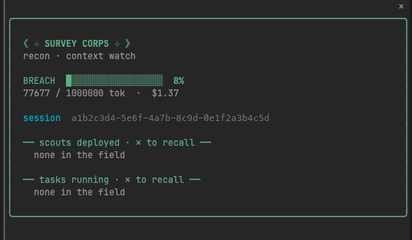
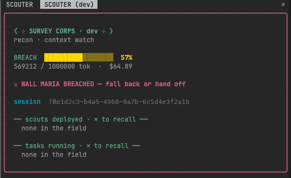
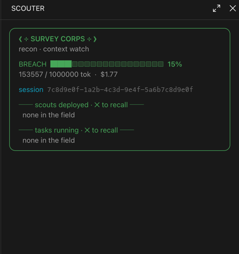

# scouter

An Attack on Titan context panel for [Claude Code](https://claude.com/claude-code), shown as a dock pane beside the chat.

- **Breach meter** — your context window as a power-level bar. It flips red and fires a toast + sound the moment usage crosses the threshold, so you hand off or wrap the session before you run out of room.
- **Scouts deployed** — live subagents with their model, turn count, elapsed time and running cost estimate. `✕ recall` stops one.
- **Tasks running** — background shells, monitors and workflows, each stoppable from the panel.
- **Recon logs** — the last 5 sessions (title + short id) for the folder Claude was launched in, so you can find and resume where you left off.
- **Session id** — always visible for copy/paste.

## Screenshots

Calm session, wall intact:



Breach — context past 50%, `WALL MARIA BREACHED`:



Docked, expanded:



<sub>Session ids in the screenshots are dummy placeholders.</sub>

## Install

It's a Claude Code plugin served from its own marketplace. Add the marketplace and install:

```
/plugin marketplace add vjsharma302001/claude-scouter-mod
/plugin install scouter@vj-mods
```

Then `/scouter` toggles the panel (it also opens on session start).

## Develop

`scouter.test.tsx` mounts the pane and asserts on the breach banner and session id. It imports `claude-code/testing` and runs under the Claude Code plugin test harness.

## Layout

| path | what |
|---|---|
| `hooks/register.tsx` | the mod: hooks, state atoms, and the pane render |
| `types/index.d.ts` | `AgentStat` / `TaskRow` and the `PluginState` augmentation |
| `fx/breach.wav` | the wall-breach alert |
| `.claude-plugin/` | `plugin.json` + `marketplace.json` |

## License

MIT
